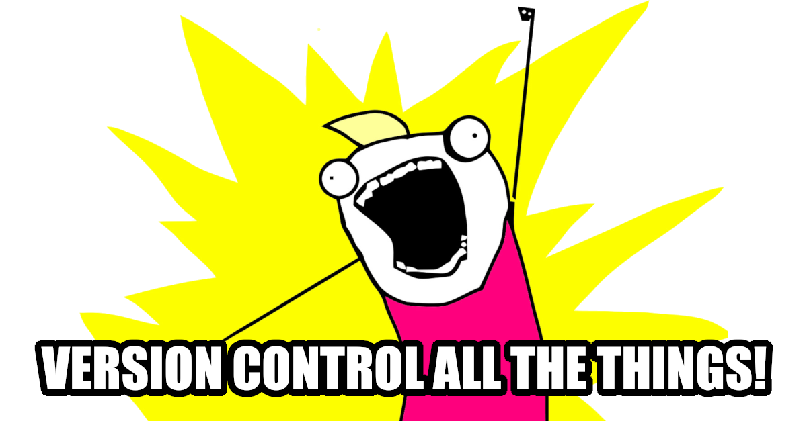
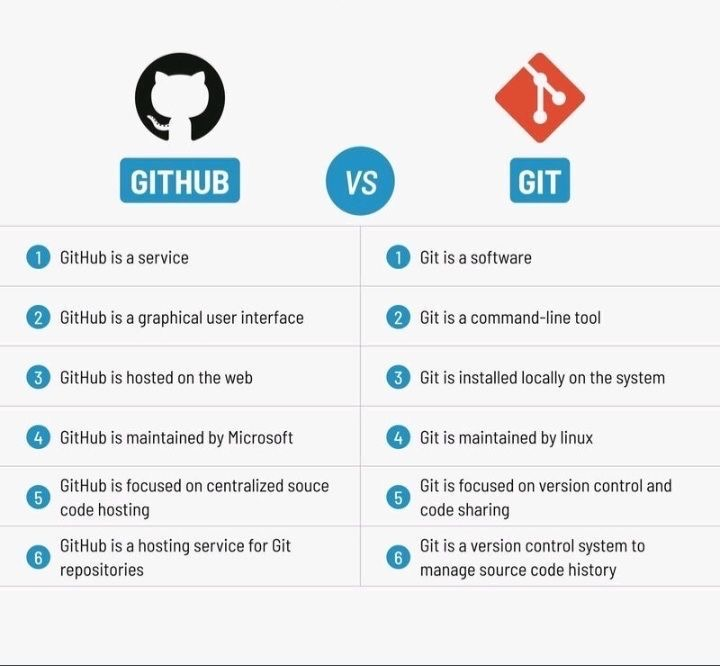
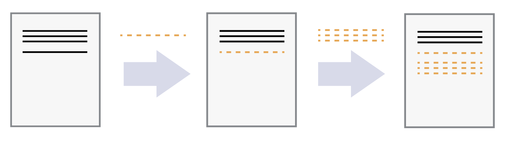
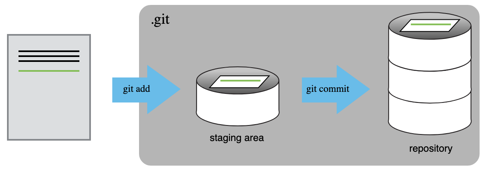
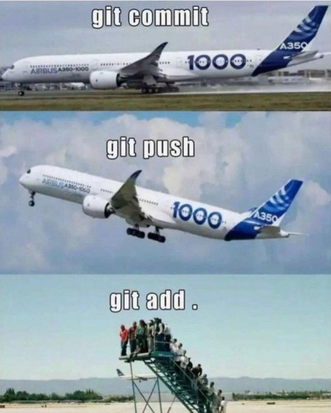
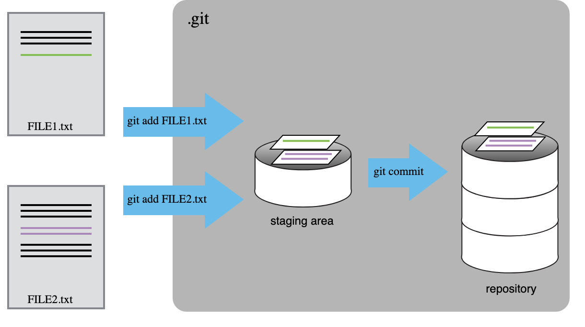

# Introducción


## ¿Dónde estamos en el curso? {.smaller}

:::: {.columns}

::: {.column width="55%"}

En las sesiones anteriores:

1. Organizamos un proyecto desde la terminal.
2. Exploramos SST/SSTA, ONI y precipitación con Python.
3. Convertimos parte del análisis en funciones y scripts.

Ahora María Luisa tiene algo valioso:

```text
notebooks/
scripts/
figures/
README.md
environment.yml
```

:::

::: {.column width="45%"}

**Nueva pregunta:**

> ¿Cómo conservamos la historia del proyecto, compartimos el trabajo y evitamos perder versiones que funcionaban?

:::

::::

. . .

Hoy usamos **Git** y **GitHub** para convertir una carpeta de trabajo en un proyecto científico reproducible.

## La pesadilla de las versiones {.smaller}


. . .

**Git evita que nuestro análisis termine como:**

```text
analisis.ipynb
analisis_final.ipynb
analisis_final2.ipynb
analisis_final_AHORA_SI.ipynb
analisis_final_AHORA_SI_corregido.ipynb
```

## Objetivos de la sesión {.smaller}

Al terminar podrán:

- distinguir **Git** de **GitHub**;
- crear un repositorio a partir de un template;
- clonar un repositorio remoto;
- revisar el estado del proyecto con `git status`;
- inspeccionar cambios con `git diff`;
- preparar cambios con `git add`;
- guardar versiones con `git commit`;
- ignorar archivos que no deben versionarse con `.gitignore`;
- enviar cambios a GitHub con `git push`;
- traer cambios remotos con `git pull`;
- resolver un conflicto sencillo en pareja.

## Lo que haremos hoy {.smaller}

```text
template en GitHub
        ↓
crear tu propio repositorio
        ↓
git clone
        ↓
copiar notebooks/scripts del análisis
        ↓
git status → git diff → git add → git commit
        ↓
.gitignore
        ↓
README
        ↓
git push
        ↓
conflicto en parejas
```

. . .

**No veremos hoy:** branches, pull requests, rebase, GitHub Actions o colaboración avanzada.

# Un poquito de contexto

## ¿Qué problema resuelve el control de versiones? {.smaller}

El control de versiones responde preguntas como:

- ¿Qué cambié desde la última versión que funcionaba?
- ¿Quién hizo un cambio?
- ¿Cuándo se hizo?
- ¿Por qué se hizo?
- ¿Cómo recupero una versión anterior?
- ¿Cómo trabajo con otra persona sin pisar su trabajo?

. . .

En investigación esto aplica a:

- scripts;
- notebooks;
- archivos `.tex` o `.qmd`;
- ambientes computacionales;
- documentación;
- figuras seleccionadas;
- workflows reproducibles.

## Un poco de historia {.smaller}

Los sistemas de control de versiones existen desde mucho antes de Git.

```text
1970s   SCCS
1980s   RCS
1990s   CVS
2000    Subversion (SVN)
2005    Git
2008    GitHub
```

Git fue creado por **Linus Torvalds** en 2005 para manejar el desarrollo del kernel de Linux después de que la comunidad Linux dejó de usar BitKeeper. Ver: [Git Book](https://git-scm.com/book/en/v2/Getting-Started-A-Short-History-of-Git), [Git history](https://git-scm.com/about), [GitHub Blog](https://github.blog/open-source/git/git-turns-20-a-qa-with-linus-torvalds/).

. . .

**Idea clave:** Git nació para proyectos grandes, distribuidos y colaborativos.

## Git no es GitHub {.smaller}



. . .

| Herramienta | ¿Qué es? |
|---|---|
| **Git** | Programa que registra la historia de cambios en tu computadora |
| **GitHub** | Plataforma web para alojar repositorios Git y colaborar |

. . .

Puedes usar Git sin GitHub.  
GitHub usa Git, pero no lo reemplaza.

## Git en ciencia {.smaller}

Ejemplos actuales de repositorios científicos:

- [ECCO Summer School sample project repository](https://github.com/ECCO-Summer-School/ESS25_sample_project_repository)
- [SalishSeaCast tools](https://github.com/SalishSeaCast/tools)
- [xarray](https://github.com/pydata/xarray)
- [MITgcm](https://github.com/MITgcm/MITgcm)
- [Tu repositorio de la clase](https://github.com/anakarinarm/enso-baja-project-template)

. . .

En proyectos científicos, Git sirve para conservar la historia del **código, documentación y configuración**.

No sustituye necesariamente a un repositorio de datos.

# Conceptos básicos

## Un repositorio {.smaller}

Un **repositorio** es una carpeta que Git está rastreando.

Contiene:

```text
proyecto/
├── .git/          # base de datos interna de Git
├── README.md
├── scripts/
├── notebooks/
└── environment.yml
```

. . .

La carpeta `.git/` guarda la historia.  
Normalmente no la editamos a mano.

## Cambios como diferencias {.smaller}



Imagen: Software Carpentry

. . .

Git piensa en términos de **cambios**.

No sólo pregunta:

> ¿qué archivo tengo?

sino:

> ¿qué cambió con respecto a la última versión guardada?

## Tres espacios importantes {.smaller}



Imagen: Software Carpentry

. . .

```text
Working directory
      ↓ git add
Staging area
      ↓ git commit
Repository local
      ↓ git push
Repository remoto en GitHub
```

## ¿Por qué existe `git add`? {.smaller}



. . .

`git add` nos permite decidir **qué cambios** entran al próximo commit.

Eso es útil cuando modificamos varias cosas pero queremos guardar la historia en pasos lógicos.

## ¿Qué es un commit? {.smaller}

:::: {.columns}

::: {.column width="55%"}



Imagen: Software Carpentry

:::

::: {.column width="45%"}

Un **commit** es una fotografía lógica del proyecto en un momento dado.

Cada commit tiene:

- un identificador único;
- autor/a;
- fecha;
- mensaje;
- cambios respecto al commit anterior.

:::

::::

## Buenas unidades de trabajo {.smaller}

Malos mensajes:

```text
update
changes
final
stuff
```

Mejores mensajes:

```text
Add SST anomaly analysis
Document precipitation data source
Fix regional mean function
Create summary figure
```

. . .

Un buen commit responde:

> ¿Qué cambio hice y por qué debería importarle a mi yo del futuro?

# Preparación inicial

## Antes de empezar {.smaller}

Cada quien necesita:

- cuenta de GitHub;
- Git instalado;
- acceso al template del curso;
- proyecto de Python de la sesión anterior.

. . .

Verificar Git:

```bash
git --version
```

Configurar identidad:

```bash
git config --global user.name "Tu Nombre"
git config --global user.email "tu_correo@ejemplo.com"
git config --global init.defaultBranch main
```

Ver configuración:

```bash
git config --list --global
```

## HTTPS o SSH {.smaller}

GitHub permite conectarse por HTTPS o SSH.

Si usas SSH, revisa:

```bash
ssh -T git@github.com
```

Una URL SSH se ve así:

```text
git@github.com:usuario/repositorio.git
```

Una URL HTTPS se ve así:

```text
https://github.com/usuario/repositorio.git
```

. . .

En clase pueden usar cualquiera de las dos. Lo importante es que puedan hacer `push`.

# El template del curso

## ¿Por qué usamos un template? {.smaller}

La estructura del proyecto **también es parte de la reproducibilidad**.

Nuestro template está adaptado de la estructura usada en la ECCO Summer School 2025:

```text
enso-baja-project-template/
├── data/
├── notebooks/
├── scripts/
├── figures/
├── .gitignore
├── environment.yml
└── README.md
```

Referencia: [ECCO Summer School sample project repository](https://github.com/ECCO-Summer-School/ESS25_sample_project_repository).

## Paso 1. Crear tu repo desde el template {.smaller}

En GitHub:

1. Abrir el template del curso.
2. Clic en **Use this template**.
3. Elegir **Create a new repository**.
4. Nombrarlo, por ejemplo:

```text
enso-baja-project
```

5. Crear el repositorio en tu propia cuenta.

. . .

Resultado esperado:

```text
github.com/tu_usuario/enso-baja-project
```

## Paso 2. Clonar el repo {.smaller}

En la terminal:

```bash
cd ~/Desktop
git clone URL_DE_TU_REPOSITORIO
cd enso-baja-project
```

Verifica dónde estás:

```bash
pwd
ls
ls -a
```

. . .

Si ves `.git/`, estás dentro de un repositorio Git.

## `git clone` vs `git init` {.smaller}

Dos formas comunes de comenzar:

| Situación | Comando |
|---|---|
| El proyecto ya existe en GitHub | `git clone URL` |
| El proyecto sólo existe localmente | `git init` |

. . .

Hoy usamos `git clone` porque el template ya vive en GitHub.

Pero conceptualmente:

```bash
git init
```

crea un repositorio Git en una carpeta local.

## Ver el remoto {.smaller}

Como clonamos desde GitHub, Git ya sabe cuál es el repositorio remoto.

```bash
git remote -v
```

Debe aparecer algo como:

```text
origin  git@github.com:usuario/enso-baja-project.git (fetch)
origin  git@github.com:usuario/enso-baja-project.git (push)
```

o una URL HTTPS.

. . .

`origin` es el nombre convencional del remoto principal.

# Primer ciclo: status, diff, add, commit

## Nuestro primer `git status` {.smaller}

```bash
git status
```

Este comando será tu mejor amigue.

Nos dice:

- en qué rama estamos;
- si hay archivos modificados;
- si hay archivos nuevos;
- qué está listo para commit;
- qué no está rastreado.

. . .

**Regla práctica:** antes de hacer algo importante, ejecuta `git status`.

## Incorporar el trabajo de Python {.smaller}

Ahora copiaremos al repositorio parte del trabajo de la sesión anterior.

Ejemplo, si tu carpeta anterior se llama `enso_baja` y está al lado del repo:

```bash
cp ../enso_baja/notebooks/*.ipynb notebooks/
cp ../enso_baja/scripts/*.py scripts/
```

También puedes copiar manualmente desde Finder/Explorer.

. . .

Luego:

```bash
git status
```

¿Qué archivos nuevos aparecen?

## Archivos rastreados y no rastreados {.smaller}

Git distingue entre:

| Estado | Significado |
|---|---|
| untracked | Git ve el archivo, pero todavía no lo está rastreando |
| modified | Git ya lo conoce y detecta cambios |
| staged | El cambio está preparado para el próximo commit |
| committed | El cambio ya quedó guardado en la historia local |

. . .

Un archivo nuevo no entra a la historia hasta que hacemos `git add`.

## Editar el README {.smaller}

Abre `README.md` y completa al menos:

```markdown
## Pregunta

¿Cómo se relaciona la variabilidad de SST frente a Baja California con ENSO?

## Datos

- NOAA OISST V2.1
- Oceanic Niño Index
- Precipitación mensual en Ensenada
```

Guarda el archivo.

Luego:

```bash
git status
```

## Ver diferencias con `git diff` {.smaller}

```bash
git diff README.md
```

`git diff` muestra cambios línea por línea.

Símbolos comunes:

```text
- línea eliminada
+ línea agregada
```

. . .

`diff` es muy útil para revisar antes de guardar una versión.

## Preparar cambios con `git add` {.smaller}

```bash
git add README.md
git status
```

Ahora `README.md` está en el **staging area**.

. . .

`git add` no crea una versión permanente.  
Sólo prepara cambios para el siguiente commit.

## Guardar una versión con `git commit` {.smaller}

```bash
git commit -m "Descripción pregunta de investigación"
```

. . .

Ahora sí existe una versión nueva en la historia local.

Verifica:

```bash
git status
```

y:

```bash
git log --oneline
```

## Reto 1. Primer commit científico {.smaller}

1. Copia tus notebooks a `notebooks/`.
2. Copia tus scripts a `scripts/`.
3. Revisa:

```bash
git status
```

4. Agrega los archivos:

```bash
git add notebooks scripts
```

5. Haz commit:

```bash
git commit -m "Agregué análisis SST y ENSO"
```

6. Revisa la historia:

```bash
git log --oneline
```

. . .

**Pregunta:** ¿por qué es mejor este commit que uno llamado `actualización`?

# Historial y recuperación básica

## Ver la historia {.smaller}

```bash
git log --oneline
```

Ejemplo:

```text
a3c21f0 Agregué análisis SST y ENSO
5b81d3a Descripción pregunta de investigación
2f4a9c1 Initial template
```

. . .

Cada línea representa un commit.

El identificador corto (`a3c21f0`) permite referirnos a una versión específica.

## Modificar y arrepentirse {.smaller}

Edita temporalmente `README.md` y escribe una línea claramente equivocada.

Luego:

```bash
git diff README.md
```

. . .

Si quieres descartar ese cambio:

```bash
git restore README.md
```

(Si quisieras recuperar una versión de README.md guardada en alún commit específico puedes hacer:
```bash
git restore --source <commit_id> -- README.md
```
)


Revisa:

```bash
git status
```

## Reto 2. Recuperar una versión {.smaller}

1. Modifica `README.md`.
2. Revisa el cambio:

```bash
git diff
```

3. Decide que no quieres conservarlo.
4. Restaura el archivo:

```bash
git restore README.md
```

5. Confirma:

```bash
git status
```

. . .

**Idea clave:** Git puede ayudarte a experimentar sin miedo, siempre que guardes versiones con commits.

# Qué debe y no debe entrar a Git

## No todo pertenece al repositorio {.smaller}


. . .

En ciencia de datos, un repositorio no siempre debe contener todo.

## ¿Qué versionamos? {.smaller}

| Archivo/directorio | ¿Git? | Comentario |
|---|---:|---|
| `README.md` | sí | documentación del proyecto |
| `environment.yml` | sí | ambiente reproducible |
| `scripts/*.py` | sí | código reutilizable |
| `notebooks/*.ipynb` | sí | análisis y notas |
| figuras finales | depende | útil si aparecen en README |
| datos grandes | no | mejor distribuir por otra vía |
| salidas de modelos | no | pueden ser enormes |
| contraseñas/tokens | jamás | riesgo de seguridad |

## Nuestro `.gitignore` {.smaller}

El template incluye:

```text
# Datos
data/*
!data/README.md

# Jupyter
.ipynb_checkpoints/

# Python
__pycache__/
*.py[cod]

# Sistema operativo / editores
.DS_Store
Thumbs.db
.vscode/
```

. . .

La carpeta `data/` existe y tiene un README, pero los archivos de datos no se suben.

## Verificar qué ignora Git {.smaller}

Copia un archivo de datos a `data/`, por ejemplo:

```text
data/sst_baja_1981_2026.nc
```

Luego:

```bash
git status
```

. . .

Ese archivo **no debería aparecer** como untracked.

Si aparece, revisa `.gitignore`.

## Reto 3. Explicar `.gitignore` {.smaller}

Abre `.gitignore` y responde:

1. ¿Por qué `data/*` ignora los datos?
2. ¿Por qué `!data/README.md` no ignora el README?
3. ¿Qué pasaría si mañana tuvieras 200 GB de salidas de un modelo?
4. ¿Versionarías `figures/`? ¿Todas las figuras o sólo algunas?

# README como parte de la ciencia

## README no es decoración {.smaller}

El `README.md` debe permitir que otra persona entienda:

- qué pregunta intentaste contestar;
- qué datos usaste;
- qué hiciste;
- cuál fue tu resultado principal;
- cómo reproducir el análisis.

. . .

Si alguien abre tu repo en seis meses, el README debe orientarla/o antes de leer el código.

## Una estructura mínima {.smaller}

```markdown
# Título del proyecto

## Pregunta

## Datos

## Métodos

## Resultados

## Cómo reproducir el análisis
```

. . .

Esto es lo mínimo para que el proyecto sea legible.

## Incluir una figura en README {.smaller}

Si decides versionar una figura final:

```text
figures/ssta_oni_summary.png
```

puedes mostrarla en el README con:

```markdown

```

. . .

Las figuras en el README ayudan a comunicar el resultado, pero deben poder regenerarse desde el código.

## Reto 4. Documentar el proyecto {.smaller}

Edita `README.md` y completa:

1. `## Pregunta`
2. `## Datos`
3. `## Métodos`

Después:

```bash
git diff README.md
git add README.md
git commit -m "Document data and methods"
```

# Enviar cambios a GitHub

## Local vs remoto {.smaller}

```text
Repositorio local
      ↓ git push
Repositorio remoto en GitHub
```

. . .

`git commit` guarda cambios **localmente**.

`git push` envía commits a GitHub.

## Primer `push` {.smaller}

```bash
git push
```

Si Git pide autenticación, sigue las instrucciones de GitHub.

Si el upstream no está configurado:

```bash
git push -u origin main
```

. . .

Abre GitHub y actualiza la página del repositorio.

¿Ves tus commits?  
¿Ves tu README actualizado?

## Reto 5. Commit vs push {.smaller}

¿Qué hace cada comando?

```bash
git add README.md
```

```bash
git commit -m "Update README"
```

```bash
git push
```

. . .

**Respuesta:**

- `add`: prepara cambios.
- `commit`: guarda una versión local.
- `push`: envía commits al remoto.

# Colaboración y conflictos

## ¿Por qué hay conflictos? {.smaller}

Un conflicto ocurre cuando Git no puede decidir automáticamente cómo combinar dos cambios.

Ejemplo:

- Persona A cambia una línea de `README.md`.
- Persona B cambia la misma línea de `README.md`.
- Ambas versiones tienen sentido.
- Git no puede escoger por nosotras/os.

. . .

Un conflicto **no es un error catastrófico**.

Es Git diciendo:

> Necesito que una persona decida qué versión final debe quedar.

## Ejercicio en parejas: logística {.smaller}

Trabajaremos en parejas.

### Persona A

Usa su repositorio del proyecto y agrega a Persona B como colaboradora en GitHub.

En GitHub:

```text
Settings → Collaborators → Add people
```

### Personas A y B

Ambas clonan el repo de A:

```bash
git clone URL_DEL_REPO_DE_A
cd enso-baja-project
```

## Preparar la línea conflictiva {.smaller}

En `README.md`, ambas personas buscan esta sección:

```markdown
## Resultados

_Resume aquí tus resultados principales._
```

La línea que inicia con `_Resume...` será modificada por ambas personas.

. . .

Asegúrense de empezar desde la misma versión:

```bash
git pull
git status
```

## Persona A: cambio SST {.smaller}

Persona A cambia la línea por:

```markdown
La SSTA frente a Baja California aumenta durante algunos eventos El Niño.
```

Luego:

```bash
git add README.md
git commit -m "Describe SST result"
git push
```

## Persona B: cambio precipitación {.smaller}

Persona B **no hace pull todavía**.

Cambia la misma línea por:

```markdown
La precipitación en Ensenada es mayor durante algunos eventos El Niño.
```

Luego:

```bash
git add README.md
git commit -m "Describe precipitation result"
git push
```

. . .

¿Qué ocurre?

## Push rechazado {.smaller}

Git probablemente dirá algo como:

```text
! [rejected] main -> main (fetch first)
error: failed to push some refs
```

Esto significa:

> El remoto tiene cambios que tu copia local todavía no tiene.

. . .

No queremos sobrescribir el trabajo de A.  
Primero debemos traer los cambios remotos.

## Traer cambios remotos {.smaller}

Persona B ejecuta:

```bash
git pull --no-rebase
```

`git pull` trae cambios del remoto e intenta mezclarlos con los locales.

`--no-rebase` indica que queremos resolverlo como un merge.

. . .

Como ambas personas cambiaron la misma línea, Git no puede decidir automáticamente.

## Marcadores de conflicto {.smaller}

En `README.md`, Persona B verá algo parecido a:

```text
<<<<<<< HEAD
La precipitación en Ensenada es mayor durante algunos eventos El Niño.
=======
La SSTA frente a Baja California aumenta durante algunos eventos El Niño.
>>>>>>> origin/main
```

Significado:

```text
<<<<<<< HEAD
tu versión local

=======
separador

>>>>>>> origin/main
versión que llegó del remoto
```

## Resolver no es elegir ciegamente {.smaller}

Podemos escribir una versión mejor que combine ambas ideas:

```markdown
La respuesta regional a ENSO no es única: exploramos tanto las anomalías de SST frente a Baja California como la precipitación en Ensenada.
```

. . .

Borra todos los marcadores:

```text
<<<<<<<
=======
>>>>>>>
```

Guarda el archivo.

## Confirmar la resolución {.smaller}

Después de editar:

```bash
git status
```

Luego:

```bash
git add README.md
git commit -m "Resolve README conflict"
git push
```

. . .

El commit de resolución queda registrado en la historia.

## Persona A actualiza su copia {.smaller}

Persona A ahora hace:

```bash
git pull
```

y recibe la versión resuelta.

. . .

Ahora ambas copias locales y GitHub tienen la misma historia.

## Lo que aprendimos del conflicto {.smaller}

```text
A trabaja       B trabaja
   ↓               ↓
A commit          B commit
   ↓               ↓
A push            B push rechazado
                   ↓
                 B pull
                   ↓
              conflicto
                   ↓
              resolver
                   ↓
             add + commit
                   ↓
                 push
```

. . .

Git no perdió el trabajo de nadie.

Git obligó a revisar explícitamente un cambio ambiguo.

# Problemas comunes

## “fatal: not a git repository” {.smaller}

Mensaje:

```text
fatal: not a git repository
```

Posibles causas:

- no estás dentro de la carpeta del repo;
- estás un directorio arriba o abajo;
- nunca clonaste/inicializaste el repositorio.

Solución:

```bash
pwd
ls -a
```

Busca `.git/`.

## “nothing to commit” {.smaller}

Mensaje:

```text
nothing to commit, working tree clean
```

Significa que Git no detecta cambios pendientes.

Puede ser bueno.

. . .

Pero si esperabas cambios, revisa:

- ¿guardaste el archivo?
- ¿estás en el repo correcto?
- ¿el archivo está ignorado por `.gitignore`?

## “remote origin already exists” {.smaller}

Mensaje:

```text
error: remote origin already exists
```

Significa que ya hay un remoto llamado `origin`.

Ver:

```bash
git remote -v
```

Cambiarlo:

```bash
git remote set-url origin NUEVA_URL
```

## Cambiar HTTPS a SSH {.smaller}

Ver remoto actual:

```bash
git remote -v
```

Cambiar a SSH:

```bash
git remote set-url origin git@github.com:usuario/repositorio.git
```

Verificar:

```bash
git remote -v
ssh -T git@github.com
```

## Push rechazado {.smaller}

Mensaje típico:

```text
Updates were rejected because the remote contains work that you do not have locally.
```

Solución usual:

```bash
git pull --no-rebase
```

Resolver conflictos si aparecen.

Después:

```bash
git push
```

# Proyecto final

## Entregable {.smaller}

Cada estudiante o pareja debe entregar un repositorio con:

```text
README.md
environment.yml
.gitignore
notebooks/
scripts/
figures/
```

Los datos pueden estar en `data/` localmente, pero no deben subirse a GitHub.

## Contenido mínimo del README {.smaller}

Debe incluir:

1. Pregunta.
2. Datos utilizados.
3. Métodos generales.
4. Una o dos figuras.
5. Interpretación breve.
6. Cómo reproducir el análisis.

. . .

No tiene que ser largo.  
Sí debe ser claro.

## Commits esperados {.smaller}

Idealmente el historial debe contar una historia:

```text
Describe project question
Add exploratory SST notebook
Add regional mean function
Create summary figure
Document results
```

. . .

Eviten un único commit final llamado:

```text
final
```

## Cierre {.smaller}

Hoy aprendimos que Git no es sólo una herramienta para programadoras/es profesionales.

En ciencia, Git ayuda a:

- pensar en cambios pequeños y documentados;
- recuperar versiones;
- trabajar con otras personas;
- separar código de datos grandes;
- compartir proyectos reproducibles;
- dejarle pistas claras a nuestro yo del futuro.

. . .

**Mensaje final:**

> Un proyecto científico no es sólo una figura final.  
> Es la historia reproducible de cómo llegamos a ella.

# Referencias y recursos

## Recursos para repasar {.smaller}

- [Software Carpentry: Version Control with Git](https://swcarpentry.github.io/git-novice-es/)
- [Pro Git Book](https://git-scm.com/book/en/v2)
- [GitHub Docs: Hello World](https://docs.github.com/en/get-started/start-your-journey/hello-world)
- [GitHub Docs: resolving merge conflicts](https://docs.github.com/en/pull-requests/how-tos/merge-and-close-pull-requests/resolving-a-merge-conflict-using-the-command-line)
- [ECCO Summer School sample project repository](https://github.com/ECCO-Summer-School/ESS25_sample_project_repository)

## Créditos {.smaller}

Estas diapositivas están basadas parcialmente en:

- la lección [Version Control with Git](https://swcarpentry.github.io/git-novice-es/) de Software Carpentry;
- el material previo del minicurso DOF 2025;
- el template de proyecto de la [ECCO Summer School 2025](https://github.com/ECCO-Summer-School/ESS25_sample_project_repository).

Adaptación para el minicurso **Introducción a herramientas computacionales para Oceanografía Física**, CICESE, 2026.
